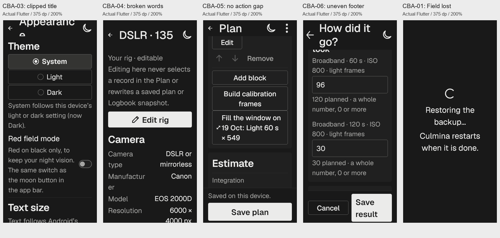

# Culmina — whole-app Concept B design audit

Status: **audit complete; findings open; no corrective implementation**, 2026-10-24.

The nine named Concept B screens have the new grouping. **The approach is not yet consistent throughout the app:** child Library pages, Plan editors/choosers, Logbook detail/Progress and Settings children retain the previous composition. The production font is consistent in the inspected UI. Six concrete visual defects remain, including two separate header problems at 200% and a standalone restore screen that loses Field presentation.

This report answers the owner's current request to inspect the whole app, compare it with the generated references and check placement/spacing against design skills. It does not authorize fixes, a blanket card migration, Git delivery or a new design direction.

## Baseline and method

- Source: `develop`, `a4798d667007a83e12de3c94d95bb68c22947748`, with the existing dirty Concept B implementation. [Pre-audit dirty-file hashes](baseline.json) were recorded before work. Production inputs still match the [implementation source receipt](../../migration/evidence/concept-b-2026-10-24/source-inputs.json). Only audit tooling, evidence and handoff documents were added/updated in this task.
- The [adopted specification](../../CONCEPT_B_IMPLEMENTATION_2026_10_24.md), current BASELINE/DESIGN_SYSTEM/WORKFLOW and the component, spacing, typography, token and rules skills were read. Impeccable's native audit/critique route runs inline: browser detector and dual-agent isolation do not apply to native Flutter. Its context was already loaded earlier in this conversation; no duplicate initialization or drift repair.
- **36/36 files under `lib/presentation/screens` mapped**, plus seven shared editor/navigation sources. Every route/screen family has a source disposition; helper/wrapper files are identified as such. [Coverage CSV](coverage.csv) / [JSON](coverage.json) list exact sources and frame names.
- **321 retained Flutter frame observations, 131 distinct frame names**, with isolated in-memory fixtures, the real router, actual production widgets and bundled fonts. App area is 375×812 logical dp at DPR 1. Dark: 124 at 100%, 136 at 200%; Light: 14 at each scale; Field: 14 at 100%, 19 at 200%. Counts include explicit duplicate utility observations, not 321 distinct screens. [Frame/hash manifest](frames-manifest.json), [statistics](audit-statistics.json), [proof sheets](contact-sheets/).
- Scrolled views, long names, no site, loading failure, missing/partial/stale/offline/no-dark weather, search with no matches, no recorded progress, empty capture plan, all three result outcomes, validation, unsaved/delete confirmations, date/zone/coordinate pickers, export preview, synthetic metadata review and restore confirmations were included. Form captures simulate **300 dp IME insets and focus**; they do not draw or certify an Android keyboard. No real file, restore/reset/share, GPS or device data operation was performed.
- New source renders are **host Flutter evidence**, not physical-device acceptance. The earlier phone observation and 75 all-theme implementation frames are reusable only at their unchanged inputs and stated scope under V3. This audit does not claim new physical 200%/TalkBack, startup/profile performance, landscape/tablet, platform file-picker/share-sheet or owner acceptance.

## Reference versus actual implementation

All nine original generated images were opened and visually inspected. They establish grouping/hierarchy, not pixel geometry or scientific values. The subsequent owner requirement for one font explicitly supersedes their serif exceptions. Texture/shading, decorative shadows, guessed icons/chevrons, exact raster typography and removed/added scientific content are not adopted requirements.

| Surface | Generated reference | Current native evidence | Assessment |
| --- | --- | --- | --- |
| Tonight | [Home B](../../explorations/2026-10-24-home-blocks/concept-b.png) | [Top](frames/dark-100/home-dark-1.png), [timeline/bottom](frames/dark-100/home_timeline-dark-1.png), [no site](frames/dark-200/home_nosite-dark-2.png) | Plan/night/next-action grouping is present. Geist instead of the generated serif is intentional. Sparse no-site/error prompts remain functional states. |
| Plan | [Concept](../../explorations/2026-10-24-concept-b-suite/concepts/plan.png) | [Top](frames/dark-100/plan-dark-1.png), [Estimate](frames/dark-100/plan_b-dark-1.png), [bottom](frames/dark-100/plan_c-dark-1.png) | Required groups and lower disclosures are present. CBA-05 concerns action spacing. Existing input-row anatomy and 48 dp targets outrank the raster's denser button arrangement. |
| Logbook | [Concept](../../explorations/2026-10-24-concept-b-suite/concepts/logbook.png) | [Index](frames/dark-100/logbook-dark-1.png), [200%](frames/dark-200/logbook-dark-2.png) | Progress/month groups present; compact badges retained and large-text rows reflow. Child details and Progress are a separate extension gap. |
| Night | [Concept](../../explorations/2026-10-24-concept-b-suite/concepts/night.png) | [Top](frames/dark-100/night-dark-1.png), [reading/disclosures](frames/dark-100/night_c-dark-1.png) | Context/answer/timeline/reading groups present. Current state stays semantically attached to the timeline; it need not be a separate raster-style card. |
| Moon | [Concept](../../explorations/2026-10-24-concept-b-suite/concepts/moon.png) | [Top](frames/dark-100/moon-dark-1.png), [calendar/time browser](frames/dark-100/moon_b-dark-1.png), [200% week view](frames/dark-200/moon_b-dark-2.png) | Answer/calendar/browser grouping present. Full grid width and the existing large-text week adaptation are preserved. |
| Weather | [Concept](../../explorations/2026-10-24-concept-b-suite/concepts/weather.png) | [Top](frames/dark-100/weather-dark-1.png), [statistics](frames/dark-100/weather_b-dark-1.png), [coming nights](frames/dark-100/weather_c-dark-1.png) | Summary/statistics/limits/details/coming-night groups present. Both compact rows and charts retain source/coverage/unknowns. Static values do not become links. |
| Library | [Concept](../../explorations/2026-10-24-concept-b-suite/concepts/library.png) | [Index](frames/dark-100/library-dark-1.png) | Three destination rows form one group. Their child surfaces retain earlier anatomy (CBA-07). |
| Settings | [Concept](../../explorations/2026-10-24-concept-b-suite/concepts/settings.png) | [Index](frames/dark-100/settings-dark-1.png) | Preferences and Data/about groups present. Child pages remain ungrouped (CBA-10). |
| Record result | [Concept](../../explorations/2026-10-24-concept-b-suite/concepts/result.png) | [Top](frames/dark-100/result-dark-1.png), [notes/conditions](frames/dark-100/result_b-dark-1.png), [200%](frames/dark-200/result_b-dark-2.png) | Outcome/counts/notes/conditions groups present; validation and conditional states retained. CBA-06 concerns footer geometry. |

## Findings by priority

**10 findings: P0 0, P1 1, P2 9, P3 0.** CBA-01–06 are reproduced defects. CBA-07–10 are grouped extension gaps against the owner's current whole-app direction; those child screens were not explicitly included in the preceding nine-screen implementation checklist. They are not claims that a generated reference exists for each child page.

### CBA-01 — P1 — Restore root loses the active Field presentation

Type: **confirmed defect**. Source: `lib/main.dart:279; lib/presentation/screens/settings/backup_section.dart:256`.

A Field user is shown neutral white text and spinner during restore instead of the red/black night-vision presentation.

Evidence: [restore_wait-field-2](frames/utility-final/restore_wait-field-2.png).

Bounded correction/proposal: Carry the effective Field theme/filter into the standalone restoring app without touching backup/data semantics. Inspect unsupported-database roots separately; their unknown persisted theme is not waived by this audit. Suggested follow-up: `$impeccable harden`.

### CBA-02 — P2 — Four record headers still force a single line

Type: **confirmed defect**. Source: `lib/presentation/screens/logbook/session_detail_screen.dart:132; lib/presentation/screens/equipment/rig_detail_screen.dart:138; lib/presentation/screens/target/target_detail_screen.dart:115; lib/presentation/screens/sites/site_detail_screen.dart:82`.

At 200%, complete record identity is visually cut to Andromed / DSLR 135 / Kyiv although the title widget contains the full name. Session dates disappear. The app bar can reserve wrapping height while the child forbids wrapping.

Evidence: [entry-dark-2](frames/dark-200/entry-dark-2.png), [lib_rig-dark-2](frames/dark-200/lib_rig-dark-2.png), [lib_target-dark-2](frames/dark-200/lib_target-dark-2.png), [lib_site-dark-2](frames/dark-200/lib_site-dark-2.png).

Bounded correction/proposal: Remove caller-imposed line clamps and verify complete names/date at 375 dp, with the shared app-bar measurement corrected. Suggested follow-up: `$impeccable typeset`.

### CBA-03 — P2 — Shared AppBar estimates 48 dp actions although the actual Field action is 64 dp at 200%

Type: **confirmed defect**. Source: `lib/presentation/shared/hybrid_app_bar.dart:43; lib/presentation/shared/field_mode_button.dart:36`.

Appearance is laid out as two lines in a 64 dp toolbar, with a text rectangle at y=-23, height 110: the title is cut off at the top. The helper measured a wider title slot than Material actually provides.

Evidence: [settings_appearance-dark-2](frames/dark-200/settings_appearance-dark-2.png), [settings_appearance-light-2](frames/theme-200/settings_appearance-light-2.png), [settings_appearance-field-2](frames/theme-200/settings_appearance-field-2.png).

Bounded correction/proposal: Measure the actual available leading/title/action constraints at the user scale, retaining full names and reachable 48 dp controls. Do not reduce text size to hide the defect. Suggested follow-up: `$impeccable layout`.

### CBA-04 — P2 — Record facts keep two narrow columns at 200%

Type: **confirmed defect**. Source: `lib/presentation/screens/settings/settings_parts.dart:455`.

FactRows shares width between Flexible label/value columns. Manufacturer breaks inside the word, units and coordinates require excessive lines, and scanning a fact pair becomes slow. There is no RenderFlex exception to catch this.

Evidence: [lib_rig-dark-2](frames/dark-200/lib_rig-dark-2.png), [lib_target-dark-2](frames/dark-200/lib_target-dark-2.png), [lib_site-dark-2](frames/dark-200/lib_site-dark-2.png).

Bounded correction/proposal: Stack each label/value/note pair when its measured width or text scale requires it; retain units, full names and tabular values. Suggested follow-up: `$impeccable layout`.

### CBA-05 — P2 — Fill the window touches the preceding capture action

Type: **confirmed defect**. Source: `lib/presentation/widgets/capture_plan_widget.dart:56; lib/presentation/screens/home/home_screen.dart:201`.

Build calibration and Fill the window share a boundary with zero gap. At 200%, calibration y=266 h=96 ends exactly where Fill y=362 begins; both are 303 dp wide, so the controls read as a joined box.

Evidence: [plan_actions-dark-1](frames/dark-100/plan_actions-dark-1.png), [plan_actions-dark-2](frames/dark-200/plan_actions-dark-2.png).

Bounded correction/proposal: Add the existing 8 dp inter-action separation at the composition boundary; keep both actions and their large-text stacking. Suggested follow-up: `$impeccable layout`.

### CBA-06 — P2 — Record result footer buttons have unequal height at 200%

Type: **confirmed defect**. Source: `lib/presentation/screens/execution/results_screen.dart:334`.

Cancel is 161.5 x 56 dp at y=724; Save result is 161.5 x 112 dp at y=696. The center-aligned Row makes the pair visibly uneven when Save result wraps. Other editors already use LibrarySaveBar with equal-height stretching.

Evidence: [result_b-dark-2](frames/dark-200/result_b-dark-2.png), [result_ime-dark-2](frames/dark-200/result_ime-dark-2.png).

Bounded correction/proposal: Use the established equal-height footer anatomy, preserve form validation/Save/Cancel, and verify with IME insets and both scales. Suggested follow-up: `$impeccable layout`.

### CBA-07 — P2 — Library child lists, records and editors retain the former composition

Type: **extension gap**. Source: `lib/presentation/screens/equipment/; lib/presentation/screens/target/; lib/presentation/screens/sites/`.

The Library index has the new grouped surface, but the next tap returns to bare list/record/form sections. Camera/Optics, position/name/zone and catalogue/own targets are separated only by whitespace or rules.

Evidence: [lib_rigs-dark-1](frames/dark-100/lib_rigs-dark-1.png), [lib_rig-dark-1](frames/dark-100/lib_rig-dark-1.png), [lib_rig_edit-dark-1](frames/dark-100/lib_rig_edit-dark-1.png), [lib_target-dark-1](frames/dark-100/lib_target-dark-1.png), [lib_site_edit-dark-1](frames/dark-100/lib_site_edit-dark-1.png).

Bounded correction/proposal: Specify coherent groups per child screen: record identity/actions, measured facts, optional detail; editor field groups and search/result sections. Preserve manage-versus-select semantics, lazy lists and the accepted current-site/saved-sites/alternative-position order. Suggested follow-up: `$impeccable shape`.

### CBA-08 — P2 — Plan choosers, capture/assumption/calibration editors and candidate list remain outside the grouping direction

Type: **extension gap**. Source: `lib/presentation/screens/home/plan_*_screen.dart; lib/presentation/screens/tonight/tonight_candidates_screen.dart; lib/presentation/widgets/capture_plan/`.

Opening an action from grouped Plan changes to a long ungrouped form or list. Site/night, exposure/count/recording, timing/storage overrides and calibration frame types have distinct reading tasks that are currently differentiated mainly by spacing.

Evidence: [plan_context-dark-1](frames/dark-100/plan_context-dark-1.png), [plan_target-dark-1](frames/dark-100/plan_target-dark-1.png), [plan_editor-dark-1](frames/dark-100/plan_editor-dark-1.png), [plan_asm-dark-1](frames/dark-100/plan_asm-dark-1.png), [plan_cal-dark-1](frames/dark-100/plan_cal-dark-1.png), [home_candidates-dark-1](frames/dark-100/home_candidates-dark-1.png).

Bounded correction/proposal: Define groups around existing tasks, preserving Apply-to-draft versus explicit Save plan, choice/search semantics, conditional fields, scientific warnings and input widths at 200%. Candidate filters and results should stay lazy/scrollable. Suggested follow-up: `$impeccable shape`.

### CBA-09 — P2 — Logbook entry details and Progress retain the old flat document

Type: **extension gap**. Source: `lib/presentation/screens/logbook/session_detail_screen.dart:137; lib/presentation/screens/logbook/progress_screen.dart:59`.

The month-grouped Logbook index opens records whose outcome/actions, planned-versus-recorded values, saved snapshot, notes and export have no corresponding surface groups. Progress similarly mixes target, filter and rig subtotals in one long page.

Evidence: [entry-dark-1](frames/dark-100/entry-dark-1.png), [entry_c-dark-1](frames/dark-100/entry_c-dark-1.png), [logbook_progress-dark-1](frames/dark-100/logbook_progress-dark-1.png).

Bounded correction/proposal: Group existing reading tasks while preserving planned/recorded separation, immutable snapshots, comparable-group rules and export/delete ownership. Avoid one card per data row. Suggested follow-up: `$impeccable shape`.

### CBA-10 — P2 — Settings child pages retain old whitespace/rule sectioning

Type: **extension gap**. Source: `lib/presentation/screens/settings/settings_screen.dart:189; lib/presentation/screens/settings/backup_section.dart:160; lib/presentation/screens/about/about_screen.dart`.

The grouped Preferences/Data index opens ungrouped Theme/Text/Units/Weather, planning defaults, privacy, backup and About documents. The parent/child visual language is inconsistent, especially in long editor pages.

Evidence: [settings_appearance-dark-1](frames/dark-100/settings_appearance-dark-1.png), [settings_planning-dark-1](frames/dark-100/settings_planning-dark-1.png), [settings_backup-dark-1](frames/dark-100/settings_backup-dark-1.png), [settings_about-dark-1](frames/dark-100/settings_about-dark-1.png).

Bounded correction/proposal: Group related existing settings, separate backup from restore and informational notices, retain immediate-versus-staged changes, persistence feedback and current Save/Cancel ownership. Suggested follow-up: `$impeccable shape`.

## What the design skills confirm

| Contract | Current evidence / disposition |
| --- | --- |
| Semantic grouping, spacing, shape | Main DocumentSection groups align at x=20, width=335 dp; default content is inset to x=36, width=303 dp. The outer gutter and 16 dp inner padding are balanced, not accidental double margins. Radius 8 and semantic surfaceSubtle are adopted. Source-owned calendar/chart width exceptions remain. |
| Centring | Night/Moon/Weather context label, date and end label share center x=187.5 at 200% in the 375 dp frame. No horizontal-centering defect was found there. Library's shared save bar stretches paired buttons correctly; the result footer is the separate exception. |
| One font and numeric roles | [5,561 visible style records](font-check.json): 5,266 Geist prose, 295 MaterialIcons; no other declared family. Explicit production family overrides also resolve to Geist. This is declared-style evidence, supplemented by actual images and the unchanged prior glyph inspection; not proof of every possible Unicode fallback. Historical Source Serif/Roboto assets and icon fonts are not extra active prose faces. |
| Full names and large text | CBA-02/03 contradict the wrapping intent; CBA-04 shows why no-overflow tests alone do not prove readable typography. Single-line editable fields/hints and compact disclosed site labels have different interaction contracts and are not automatically defects. |
| Functional tokens and scientific display | Normal app routes stay semantic Light/Dark/Field; Field is red/black in inspected ordinary routes and dialogs. CBA-01 is a root replacement escape. Sky ramps, Moon lane, status cues and chart colors are functional, not prohibited decoration. Unknowns, units, provenance, theoretical/observed values and planned/recorded distinctions remain visible. |
| Native controls and progressive disclosure | Material dialogs, a functional map, date/zone pickers, export confirmations and sparse recovery messages do not require DocumentSection wrappers. Standard system/OS surfaces are not a reason to recreate native controls. |
| Existing grouping beyond the nine screens | Welcome and metadata review already have semantic Card sections. They are **partial/pre-existing grouping**, not wholly untreated screens. Their bordered/small-radius card anatomy differs from DocumentSection; any unification should be a specific decision, not blind wrapper replacement. |

The practical consistency gap is parent-to-child composition, followed by shared large-text anatomy. Adding backgrounds alone would leave the title/fact/action problems untouched.

## Coverage and technical limits

The source inventory covers every file under `lib/presentation/screens` and records its rendered family or helper role. All routes in `app_router.dart` are represented directly or through their alias/entry action; Record detail/editor pages pushed with Navigator are also listed. The complete capture set includes 131 frame names, not an assertion of every possible data or operating-system permutation.

The native audit's scored dimensions are: accessibility **2/4** (visual text issues; TalkBack not measured), theming **2/4** (semantic normal routes, Field root escape), platform conformance **3/4** (native controls/insets, visible text exceptions), phone text adaptivity **2/4** (100/200% reflow with the recorded defects). **9/16 of the measured dimensions**, a scoped improvement indicator only. Performance is **not scored**: source inspection shows lazy Logbook/chooser behavior retained, but no startup/frame-time/profile run was done. No /20 total, tablet verdict or accessibility certification is inferred.

Earlier harness failures were fixture preparation errors: a missing AstroBin provider, attempting a disabled Add-rig action before choosing a camera class, and requesting the automatic-name affordance on an existing saved site. Those inputs were corrected, the affected captures rerun, and the original invocation logs preserved. The final selected frame metadata has no route/layout exceptions. A case initially labelled empty Logbook still contained the fixture's saved plan; it was rerun without saving that plan and checked visually. Only its corrected empty-state evidence is retained as the final observation.

Horizontal chart labels outside the viewport belong to clipped horizontal scrollers and are not reported as overflow defects. A contact sheet made the large date-picker digits appear crowded; full-resolution review and their measured rectangles showed no overlap, so that candidate was rejected. The month title truncation in the stock picker is recorded only as a bounded observation, not a new custom-calendar requirement. No generated texture/font/icon artifact was promoted to a requirement.

## Recommended work order

1. **CBA-01 — `$impeccable harden`**: preserve Field through the restoring root; keep the backup/data contract untouched.
2. **CBA-02/03/04 — `$impeccable layout` and `$impeccable typeset`**: correct shared title constraints/full names and record fact reflow at 375 dp/200%.
3. **CBA-05/06 — `$impeccable layout`**: restore capture-action separation and equal-height result actions.
4. **CBA-07/08/09/10 — `$impeccable shape`**: specify the child-page group anatomy before implementation, reusing existing controls and preserving full functions. A sensible package order is Library children, Plan editors, Logbook detail/Progress, then Settings children.
5. **`$impeccable polish`**, then rerun the affected native audit views. Keep checks proportional under V1–V8; host, phone, TalkBack and owner acceptance remain distinct.

Questions skipped: the owner requested an audit and information gathering; no corrective implementation package has been selected. The audit ends here. Findings, existing acceptance criteria and release gates remain open at their respective boundaries.
