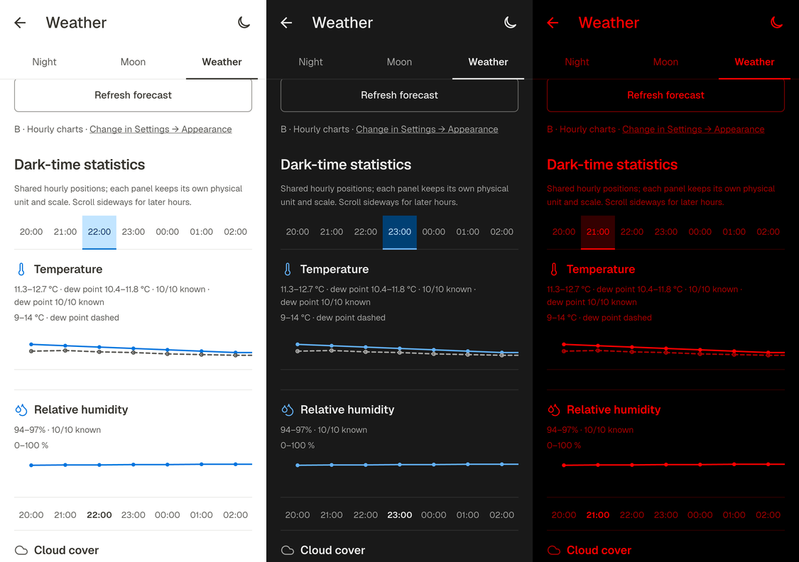

# Physical-phone re-check of P-1 through P-6 (2026-10-23)

> Delivery update: the owner subsequently authorized committing and pushing this verified state to `develop`. See [Git delivery](PHONE_QA_FIXES_DELIVERY_2026_10_23.md); uncommitted-state statements below describe the earlier snapshots.

**Result: PASS for the six scoped fixes at 100 percent text on the physical phone.** No new defect was found in the exercised scenarios. This is a follow-up to [the fix plan](PHONE_QA_FIX_PLAN_2026_10_23.md), not a full application/release acceptance audit. Owner acceptance is not recorded.

## Build and installation

| Item | Evidence |
| --- | --- |
| Source | `C:/Users/zalub/AppData/Local/Temp/culqa`, branch `fix/qa-02-save-status`, HEAD `35992c93c6c4e43385694d101e2a9cfea406898d` plus the uncommitted P-1 through P-6 changes documented in [the implementation report](PHONE_QA_FIXES_IMPLEMENTATION_2026_10_23.md) |
| Build | `C:/flutter/bin/flutter.bat build apk --release`, successful, Gradle 76.1 s; no `--no-pub`; dependency/Android source diff unchanged |
| Mode and signing | Release-mode APK, signed with the existing Android Debug certificate because `android/key.properties` is absent. A local verification build; no store/release publication, signing-key creation or secret access |
| Package/version | `io.github.buffur.culmina`, `1.0.0+1`, minSdk 24, targetSdk 36 |
| APK | `C:/Users/zalub/CulminaQA/2026-10-23/fixes-recheck/culmina-p1-p6-release-debug-signed.apk`, 74,958,274 bytes |
| SHA-256 | `b6588ecb2675ef8eb8d84e406f6224c6891a940bfee63bcda336be675dfe011e` |
| Certificate SHA-256 | `56d00b35cb297aceabc42aef7033d41a7b5c7a1939e7d14cf7329672f8902dbe`, same as the previously installed APK |
| Installation | `adb -s PRRGPZ8PZ5E6OJ7T install -r`: Success. Existing data/initial draft survived. Installed base APK pulled back and its SHA-256 equals the new build exactly |
| Device | Xiaomi 14T Pro (`2407FPN8EG`), Android 16, serial `PRRGPZ8PZ5E6OJ7T`, 1220 x 2712 px, 520 dpi; app area about 375.4 x 792 dp; font scale 1.0 |
| Startup | First launch after update: 796 ms. Final cold launch after restoring original test data: 368 ms (`am start -W`) |

Build log includes existing Kotlin migration/plugin warnings and a Cupertino font-family/tree-shaking warning. They did not fail compilation; no plugin, dependency or font change was made for this re-check.

## Device checks

| Fix | Steps and observed result | Evidence |
| --- | --- | --- |
| P-1 / QA-02 / TD-114 | Choose the seeded rig for the backed-up draft; Save. Dark: first edit Light count 120 to 121, Apply; both `Saved · changed` and `Changes are not saved yet.` appear immediately, without a second edit. Save returns `Saved` and `Saved on this device.`. Repeat in Light, 121 to 122: same result. Screenshot/XML assertions pass for both edit/save cycles | `plan-first-edit-dark-top`, `plan-first-edit-light-top`, `plan-resaved-dark`, `plan-resaved-light` |
| P-2 / QA-04 / TD-115 | Primary labels are visibly stronger: Library Add rig/Edit rig in Light, Edit rig in Field, Save and leave in all three themes; Apply changes used in both edit cycles. No clipping or overlap observed. Exact 16/600 weight is pinned by the existing theme tests; a screenshot alone does not expose a numeric font weight | `rig-detail-light`, `rig-detail-field`, `unsaved-*`; host `controls_theme_test` reused |
| P-3 / QA-05 / TD-116 | Open New plan while the saved plan has changes in Light/Dark/Field; Cancel and Discard share y=1433..1589 px; Save and leave is below at y=1615..1771, its right edge equals Discard at x=1077. Gaps are 26 px = 8 dp. Cancel returns to the same edited plan in each theme | `unsaved-light`, `unsaved-dark-enabled`, `unsaved-field`; XML geometry assertions |
| P-4 / QA-06 / TD-117 | Select Night, Moon and Weather in each of Light/Dark/Field: active label and underline move correctly. Pixel checks confirm primary colour in the selected label and secondary colour in both inactive labels for all nine states. No clipping at 100 percent | `night-*`, `moon-*`, `weather-*-selected`; nine screenshot colour assertions |
| P-5 / QA-07 / TD-118 | Open Exact times and scroll through sky intervals, Sun events, dark time, Moon and target windows. Value columns and both lines of intervals align with the right content edge in Light/Dark/Field; no overlap or clipping observed | `exact-light-intervals/events`, `exact-dark-intervals/events`, `exact-field-intervals/events` |
| P-6 / QA-08 / TD-119 | Weather B: select 22:00 in Light, 23:00 in Dark and 21:00 in Field. The selected cell moves, old cells return to normal. Raw screenshot pixels exactly match all three expected roles per theme (below). Field screenshot app area has zero pixels with nonzero green/blue | `weather-light-chart`, `weather-dark-selected`, `weather-field-selected`; pixel assertions |

Weather B pixel results (fill / text / bottom rule):

| Theme | Actual equals expected |
| --- | --- |
| Light | `#c2e5ff / #113264 / #0d74ce` |
| Dark | `#004074 / #c2e6ff / #70b8ff` |
| Field | `#330000 / #ff0000 / #ff0000` |

## Data, runtime and cleanup

- Before any test edit, the app's Back up now produced a backup, saved locally through RAR into Downloads, then pulled and extracted on the PC. ZIP CRC passed. The backup contains the original one-plan state and settings. No backup or message was sent to a person or cloud account.
- Only the existing draft was changed for the edit/save tests: the seeded rig was selected, the plan saved, Light count changed 120 to 121 to 122. No new rig/site/target/result was created. No other Culmina or legacy Astro Planner package was opened or modified; RAR and Android DocumentsUI were used only for local backup handling.
- After verification the original backup was restored through Culmina's validated Restore and restart flow (confirmed as the backup made 23 Oct at 16:41, one plan). The original unsaved Andromeda draft, no rig, four blocks/180 total frames and Light 120 x 60 s returned. Theme System, Weather A, Field off, units and planning/privacy settings returned to their original values. Final cold restart preserved this state. The new APK remains installed.
- Raw backups and full-resolution images are local only at `C:/Users/zalub/CulminaQA/2026-10-23/fixes-recheck/`. Recovery copies remain there and in the phone's Downloads (`astroplan-backup-2026-10-23-1641.rar`, `culmina-before-p1-p6-tests-20261023-1641.astroplan`). No uninstall, `pm clear`, `flutter drive`, or permission-dialog tap was performed.
- App-process logcat before restore (PID 29666) and after the final cold start (PID 9979): zero matches for `E/flutter`, `FATAL EXCEPTION`, `ANR in`, or `Unhandled Exception`. This is bounded log evidence, not performance profiling or proof of all failure paths.
- USB/ADB disconnected during the first Moon transition. After reconnect, SuperDisplay's ADB 1.0.40 conflicted with SDK ADB 1.0.41. Switching the client to `C:/Program Files/SuperDisplay/adb/adb.exe` restored access. The temporary independent server on port 5038 was stopped; SuperDisplay was not manually stopped or reconfigured. No app failure was inferred from the connection loss.

## Evidence and limits

[Evidence directory](evidence/phone-fixes-recheck-2026-10-23/): 28 curated app-only screenshots, each cropped to remove the 138 px status bar and scaled to 40 percent (488 x 1030); full-resolution originals remain local. Composite uses the three real phone screenshots, cropped/resized only. System share/file pickers and backup contents are excluded from repository evidence.

Machine checks: [tab/dialog/save assertions](evidence/phone-fixes-recheck-2026-10-23/assertions.json), [pixel colours](evidence/phone-fixes-recheck-2026-10-23/pixel-checks.json), [runtime](evidence/phone-fixes-recheck-2026-10-23/runtime-check.json), [build](evidence/phone-fixes-recheck-2026-10-23/build-release.log), [signature](evidence/phone-fixes-recheck-2026-10-23/signature.txt), [cold start](evidence/phone-fixes-recheck-2026-10-23/cold-start.txt).

The earlier cumulative host result (**2463 passed, 6 skipped**, clean analysis/format/encoding) remains applicable: no application/test/dependency source was changed in this phone run. It was not rerun merely for a new timestamp.

Not exercised in this run: physical-phone 125/200 percent text, TalkBack, the P-1 site-change variant, all primary buttons on every screen, offline/error/provider scenarios, QA-03 permission outcome, QA-10 measurement, or the remainder of the earlier full phone QA coverage. Existing host tests cover 200 percent and the site-change variant; they are not physical-device evidence. No hot reload was attempted on this release-mode APK. No commits, push, merge or publication. The six named fixes pass the exercised phone scope; broader release gates and owner acceptance are not closed here.
